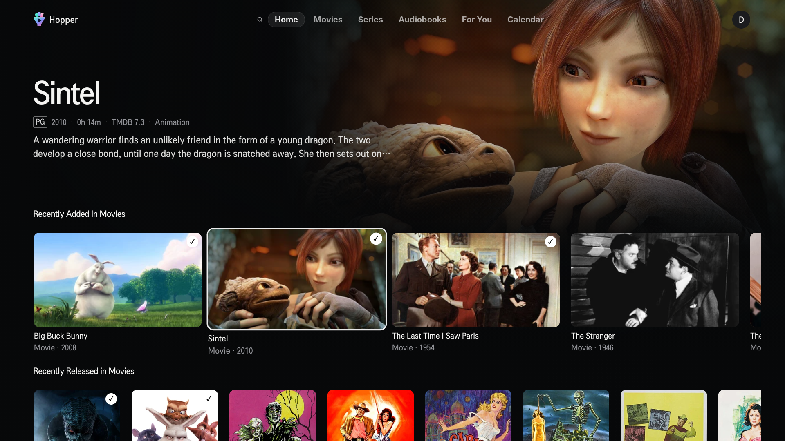
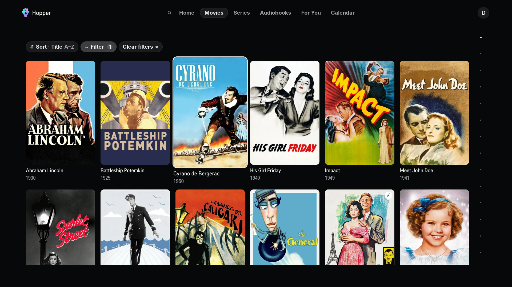
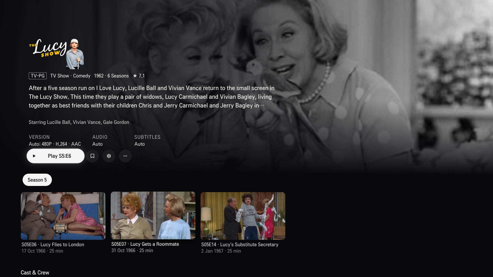

  

<h1 align="center">Hopper</h1>

  A fast, remote-first client for your own <a href="https://siloserver.org/">Silo</a> media server, built for LG webOS TVs.

Hopper is an independent, community-built client. It is not affiliated with or endorsed by the Silo project. "Silo" is a trademark of its owners and is used here only to describe compatibility.

> [!NOTE]
> Hopper 1.0 has been submitted to the LG Content Store and is waiting for LG's review. Until it's approved, you can install the [latest release](https://github.com/wjbeckett/hopper-webos/releases/latest) on a TV in Developer Mode. See [CONTRIBUTING.md](CONTRIBUTING.md).

## Availability

| Channel | Status | Version | Notes |
| --- | --- | --- | --- |
| LG Content Store | In review (submitted 16 November 2026) | 1.0.388 | Waiting for LG's QA |
| GitHub Releases (IPK) | Available | 1.0.388 | [Latest release](https://github.com/wjbeckett/hopper-webos/releases/latest), sideload with LG Developer Mode |
| Build from source | Available | 1.0.x (every build has its own number) | Sideload with LG Developer Mode |

## Screenshots

| Home | Details |
| --- | --- |
|  |  |
| **Movies** | **Series** |
|  |  |

Captured on an LG TV against the public Silo demo server, using public-domain and Blender open-movie content.

## Features

**Getting started**
- Phone pairing: the TV advertises itself on your network over mDNS. In the Silo phone app, choose "Sign in on TV" and pick the TV. The phone sends the server and approves the sign-in, so there's nothing to type with the remote. This is the first screen whenever the TV is signed out; a button on it leads to code sign-in.
- Sign in with a QR code or a code on another device, or with a username and password. If your server allows it, create an account on the TV with an invite code.
- First-run setup for a brand-new Silo server.
- Several saved servers, with switching and removal.

**Profiles**
- "Who's watching?" profile picker with PIN-protected profiles.
- Create, edit and delete household profiles: avatars, PIN, child profiles, rating limits and library access.

**Browsing**
- Home and per-library rows set by the server. Each row has a large hero backdrop and an "Explore all" page.
- Continue Watching with a time-left ring. It updates live when you watch on another device.
- Movies, TV, music and audiobook libraries, with sorting, filters, an A–Z jump bar, collections and shuffle. Music libraries can also be browsed by genre.
- Details pages with cast and crew, trailers and extras, facts, related titles and theme music. When the server has AI translation set up, a description in another language can be translated, on Details and Series pages and, automatically, for episodes.
- Series pages with season tabs, episode rails and spoiler protection for unwatched episodes.
- Search, calendar, watchlist, favorites, history and media requests. Requests are in the profile menu, where you can also remove a request that failed; a household manager can turn requests off for one profile. Home and library pages show rows of collections when the server has them. Rate movies and series with stars, and mark titles Not Interested from the For You and Recommended pages to tune your recommendations. Movie box sets show on a movie's page and in search, with a page of their own.
- Hold OK on a card for quick actions: mark watched, favorite and watchlist.
- Poster badges for resolution, HDR, audio, ratings and more, following the card overlay settings on your Silo server. Settings → General → Poster Badges turns them off for the profile.
- An accent colour on progress bars and switches, with a soft glow of it behind the screens: your server's, set by its admin, or one each profile picks for itself in Settings → General.

**Playback**
- Silo decides direct play, remux or transcode for each file, based on what the TV can play.
- HLS playback with resume, seek previews (trickplay), chapter markers, and skip intro and credits.
- Up Next with an auto-play countdown, "Still watching?" prompts and shuffle.
- Audio, subtitle, version and quality switching while you watch.
- Titles with several editions open on the standard cut, or on the one you last watched; Playback Options switches between them.
- MP4 files the TV can open (H.264 or HEVC with AAC) play directly, so the server only sends the file.
- On a slow connection, quality lowers when playback keeps buffering (or asks first, per the "Lower quality when buffering" setting), with an option to restore it.
- Subtitle appearance, sync and online search (when the server has a subtitle provider), plus AI subtitle translation where the server supports it.
- Sleep timer, audio delay, and HDR / Dolby Vision options.
- Dolby Digital and Dolby Digital Plus audio is sent to the TV untouched, so the TV can pass it to a soundbar or receiver. If the stream fails, playback starts again where it stopped, and the server converts the audio if it fails a second time.

**Built for the TV**
- Phone remote: the Silo phone app on the same network finds the TV and controls what's playing (play, pause, seek, audio and subtitles, quality, mute, next episode), and can start a title on the TV. A title started from a phone on another profile plays as that profile, once the phone approves it, and the TV shows "Playing as <profile> · From <phone>". If another profile's title is playing, the phone asks before replacing it. The TV has to be showing Hopper, with a profile open. The first time a phone connects, the TV asks whether to allow it; Settings → Server lists the allowed phones, and you can forget one there.
- Every screen works with arrows, OK and Back on the LG remote, and the remote's media keys control playback.
- The Magic Remote pointer works too: point at a control to select it, use the arrows at the ends of a row to see more of it, scroll with the wheel, and click the timeline to seek.
- Press Home during a video and Hopper stops it with its position saved; when you come back you're on its page, ready to resume.
- Text sized to be read from the sofa: at least 20 px at the default size, as LG recommends, with larger descriptions. A larger text size chosen in the profile's appearance settings on the server is followed.
- An animated startup splash, and performance tuning for older webOS TVs.
- If the server can't be reached, Hopper says so, keeps trying, and carries on when it answers: screens load again and a video resumes where it stopped. If the server ends your sign-in, you return to the sign-in screen for the same server.
- Settings for General, Playback, Subtitles, Diagnostics and Server, laid out like the official Android TV client.
- Diagnostics stay on the TV. Logs can be viewed or exported, and are never uploaded.
- Your sign-in is stored encrypted on the TV, and your password is never stored.

## Known limitations

- **Audiobooks** play in the video player. Multi-part books don't have one continuous timeline yet, and bookmarks are missing.
- **TV models:** Hopper needs webOS 6 (2021 TVs) or later. Playback has been tested on one LG TV (webOS 22). Other webOS versions and codecs haven't been fully tested, and webOS 6 hasn't been tried on a TV yet.
- **Phone remote:** the phone can't open Hopper on the TV, and can't start a title while the TV shows the profile picker or uses a different Silo server. The connection between phone and TV isn't encrypted, as with Silo's other TV apps.
- **Connection errors:** the connection-lost and signed-out screens have been tested in a desktop browser only, not yet on a TV.
- **Audio delay** can only delay audio by 0 to 1000 ms. It can't move audio earlier.
- **Playback speed** isn't available. The TV ignores speed changes on streamed video, so Hopper doesn't offer it.
- **Watch Party** isn't available. It's experimental and switched off in the official Android TV app too.

## Contributing

Bug reports and focused pull requests are welcome. [CONTRIBUTING.md](CONTRIBUTING.md) covers setup, running in a browser, deploying to an LG TV and project conventions.

## Brand

The Hopper icon, splash and store artwork are made from SVG sources in [`brand/`](brand/README.md).

## License and trademarks

Hopper is free software, licensed under the [GNU Affero General Public License v3.0 or later](LICENSE) (`AGPL-3.0-or-later`), the same licence as Silo. You can use, study, change and share it. If you distribute a changed version, or run one as a network service, you must make its source available under the same licence.

The licence covers the code, not the brand. The Hopper™ name, mark and artwork are reserved. Forks you distribute need their own name and icon, and publishing to an app store as Hopper needs permission. See [TRADEMARK.md](TRADEMARK.md).

The bundled Inter fonts are under the SIL Open Font License (`public/fonts/OFL.txt`).

The Silo name and logo are trademarks of Silo Media L.L.C. They are not part of this project.
