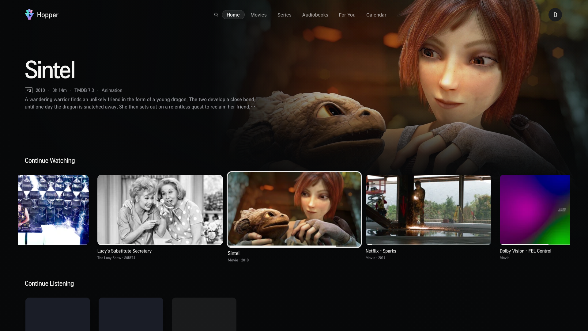
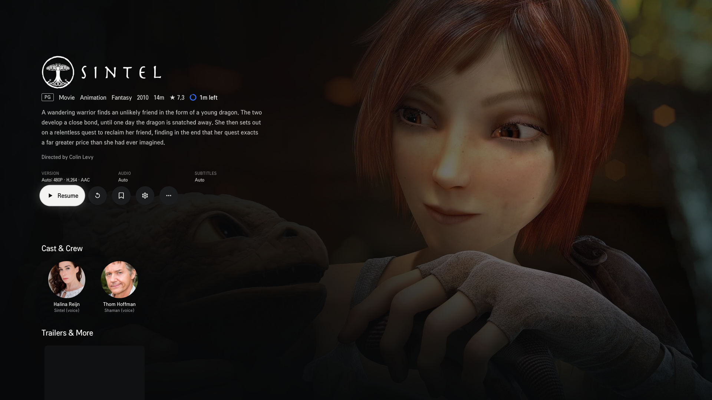
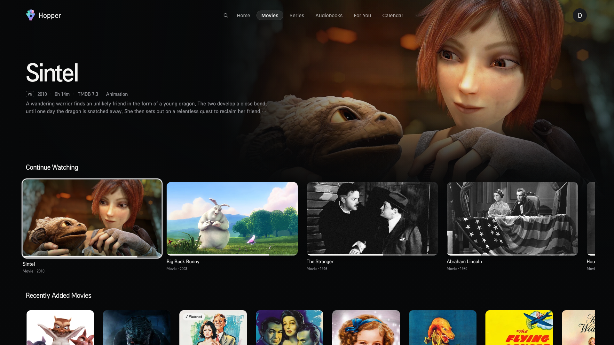
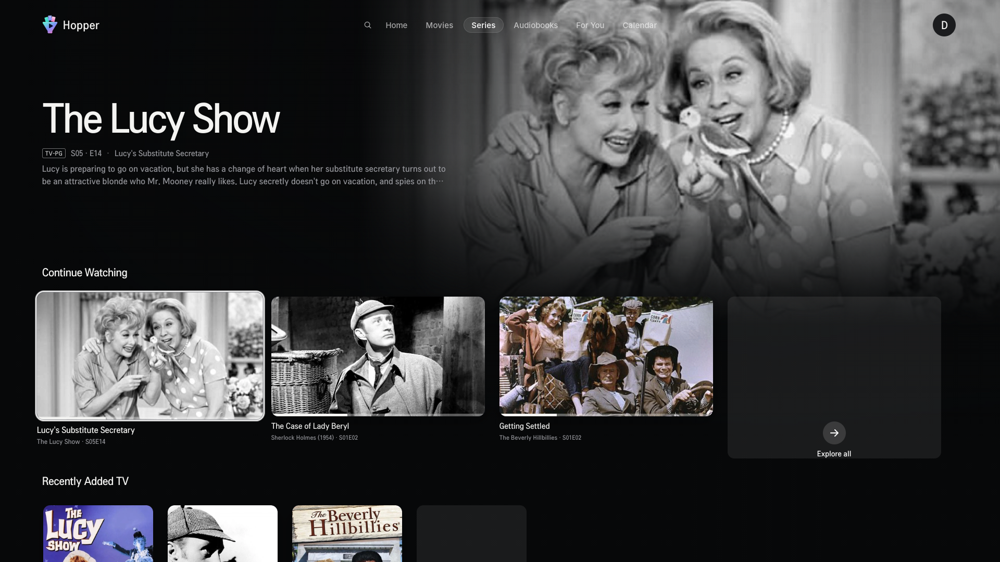

  

<h1 align="center">Hopper</h1>

  A fast, remote-first client for your own <a href="https://siloserver.org/">Silo</a> media server, built for LG webOS TVs.

Hopper is an independent, community-built client. It is not affiliated with or endorsed by the Silo project. "Silo" is a trademark of its owners and is used here only to describe compatibility.

> [!NOTE]
> Hopper is in active development and is not yet in the LG Content Store. You can sideload it on a TV in Developer Mode. See [CONTRIBUTING.md](CONTRIBUTING.md).

## Availability

| Channel | Status | Version | Notes |
| --- | --- | --- | --- |
| LG Content Store | Not yet submitted | – | Store assets and listing are ready |
| GitHub Releases (IPK) | Not yet published | – | |
| Build from source | Available | 0.3.x (every build has its own number) | Sideload with LG Developer Mode |

## Screenshots

| Home | Details |
| --- | --- |
|  |  |
| **Movies** | **Series** |
|  |  |

Captured on an LG TV against the public Silo demo server, using public-domain and Blender open-movie content.

## Features

**Getting started**
- Phone pairing: the TV advertises itself on your network over mDNS. In the Silo phone app, choose "Sign in on TV" and pick the TV. The phone sends the server and approves the sign-in, so there's nothing to type with the remote. This is the first screen whenever the TV is signed out; a button on it leads to code sign-in.
- Sign in with a QR code or a code on another device, or with a username and password. If your server allows it, create an account on the TV with an invite code.
- First-run setup for a brand-new Silo server.
- Several saved servers, with switching and removal.

**Profiles**
- "Who's watching?" profile picker with PIN-protected profiles.
- Create, edit and delete household profiles: avatars, PIN, child profiles, rating limits and library access.

**Browsing**
- Home and per-library rows set by the server. Each row has a large hero backdrop and an "Explore all" page.
- Continue Watching with a time-left ring. It updates live when you watch on another device.
- Movies, TV, music and audiobook libraries, with sorting, filters, an A–Z jump bar, collections and shuffle.
- Details pages with cast and crew, trailers and extras, facts, related titles and theme music.
- Series pages with season tabs, episode rails and spoiler protection for unwatched episodes.
- Search, calendar, watchlist, favorites, history and media requests.
- Hold OK on a card for quick actions: mark watched, favorite and watchlist.

**Playback**
- Silo decides direct play, remux or transcode for each file, based on what the TV can play.
- HLS playback with resume, seek previews (trickplay), chapter markers, and skip intro and credits.
- Up Next with an auto-play countdown, "Still watching?" prompts and shuffle.
- Audio, subtitle, version and quality switching while you watch.
- MP4 files the TV can open (H.264 or HEVC with AAC) play directly, so the server only sends the file.
- Subtitle appearance, sync and online search, plus AI subtitle translation where the server supports it.
- Playback speed, sleep timer, audio delay, and HDR / Dolby Vision options.
- Dolby Digital and Dolby Digital Plus audio is sent to the TV untouched, so the TV can pass it to a soundbar or receiver. If the stream fails, playback starts again where it stopped, and the server converts the audio if it fails a second time.

**Built for the TV**
- Every screen works with arrows, OK and Back on the LG remote, and the remote's media keys control playback.
- The Magic Remote pointer works too: point at a control to select it, use the arrows at the ends of a row to see more of it, scroll with the wheel, and click the timeline to seek.
- Press Home during a video and it pauses with its position saved, then carries on when you come back.
- Text sized to be read from the sofa: at least 20 px at the default size, as LG recommends, with larger descriptions. A larger text size chosen in the profile's appearance settings on the server is followed.
- An animated startup splash, and performance tuning for older webOS TVs.
- If the server can't be reached, Hopper says so, keeps trying, and carries on when it answers: screens load again and a video resumes where it stopped. If the server ends your sign-in, you return to the sign-in screen for the same server.
- Settings for General, Playback, Subtitles, Diagnostics and Server, laid out like the official Android TV client.
- Diagnostics stay on the TV. Logs can be viewed or exported, and are never uploaded.
- Your sign-in is stored encrypted on the TV, and your password is never stored.

## Known limitations

- **Audiobooks** play in the video player. Multi-part books don't have one continuous timeline yet, and bookmarks are missing.
- **TV models:** playback has been tested on one LG TV (webOS 22). Other webOS versions and codecs haven't been fully tested.
- **Connection errors:** the connection-lost and signed-out screens have been tested in a desktop browser only, not yet on a TV.
- **Audio delay** can only delay audio by 0 to 1000 ms. It can't move audio earlier.
- **Not implemented yet:** "Translate description" on details pages.
- **Watch Party** isn't available. It's experimental and switched off in the official Android TV app too.

## Contributing

Bug reports and focused pull requests are welcome. [CONTRIBUTING.md](CONTRIBUTING.md) covers setup, running in a browser, deploying to an LG TV and project conventions.

## Brand

The Hopper icon, splash and store artwork are made from SVG sources in [`brand/`](brand/README.md).

## License and trademarks

Hopper is free software, licensed under the [GNU Affero General Public License v3.0 or later](LICENSE) (`AGPL-3.0-or-later`), the same licence as Silo. You can use, study, change and share it. If you distribute a changed version, or run one as a network service, you must make its source available under the same licence.

The licence covers the code, not the brand. The Hopper™ name, mark and artwork are reserved. Forks you distribute need their own name and icon, and publishing to an app store as Hopper needs permission. See [TRADEMARK.md](TRADEMARK.md).

The bundled Inter fonts are under the SIL Open Font License (`public/fonts/OFL.txt`).

The Silo name and logo are trademarks of Silo Media L.L.C. They are not part of this project.
